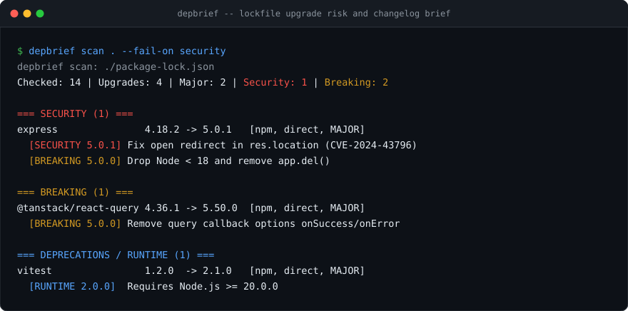

<h1 align="center">depbrief</h1>

<p align="center">
  <strong>Single-binary CLI that turns lockfile upgrades into one breaking-change and security brief.</strong><br>
  Go 1.22+ standard library only &middot; zero external dependencies &middot; npm, pnpm, Cargo, uv, and Go
</p>

<p align="center">
  <a href="https://github.com/Hinikaa/depbrief/actions/workflows/ci.yml"></a>
  <a href="https://github.com/Hinikaa/depbrief/releases"></a>
  
  
  <a href="LICENSE"></a>
</p>

<p align="center">
  
</p>

---

## Why

`npm outdated` and `cargo outdated` print version numbers without telling you what broke across skipped minor or major releases. `depbrief` parses your lockfile (or diffs two lockfiles), resolves updated dependencies to their upstream GitHub repositories, fetches every intermediate GitHub Release and `CHANGELOG.md` section in `(from, to]`, strips bot/chore noise, and groups actionable entries into `SECURITY`, `BREAKING`, `DEPRECATIONS / RUNTIME`, and `OTHER UPGRADES`.

## Install

Download a prebuilt static binary from [Releases](https://github.com/Hinikaa/depbrief/releases) (`linux/amd64`, `linux/arm64`, `darwin/amd64`, `darwin/arm64`, `windows/amd64`, `windows/arm64`):

```sh
curl -fsSLO https://github.com/Hinikaa/depbrief/releases/download/v0.1.0/depbrief_0.1.0_linux_amd64.tar.gz
curl -fsSLO https://github.com/Hinikaa/depbrief/releases/download/v0.1.0/checksums.txt
sha256sum --ignore-missing -c checksums.txt
tar -xzf depbrief_0.1.0_linux_amd64.tar.gz depbrief
```

Or install / build with Go:

```sh
go install github.com/Hinikaa/depbrief/cmd/depbrief@latest
go build -o depbrief ./cmd/depbrief
```

## Usage

Scan a directory for outdated dependencies:

```sh
depbrief scan .
depbrief scan ./services/api --format markdown --fail-on security
```

Diff two lockfiles directly:

```sh
depbrief diff old/package-lock.json new/package-lock.json
depbrief diff Cargo.lock.old Cargo.lock.new --no-changelog --format json
```

Run the included offline fixture demo:

```sh
./demo/run-demo.sh
```

Set `GITHUB_TOKEN` in the environment to raise GitHub API rate limits when fetching releases across many packages.

## Flags

| Flag | Default | Description |
| --- | --- | --- |
| `--format` | `text` | Output format: `text`, `markdown`, or `json` |
| `--direct-only` | `true` | Limit to direct dependencies when a manifest or direct marker exists |
| `--major-only` | `false` | Report major version upgrades only |
| `--concurrency` | `6` | Maximum concurrent upstream HTTP requests |
| `--fail-on` | `none` | Exit with code `1` on findings: `breaking`, `security`, or `none` |
| `--no-changelog` | `false` | Version comparison only; skip GitHub release and changelog requests |
| `--ecosystem` | `auto` | Override lockfile detection: `auto`, `npm`, `pnpm`, `cargo`, `uv`, or `go` |

Exit codes: `0` clean, `1` `--fail-on` condition triggered, `2` error.

## Supported Ecosystems and Lockfiles

| Ecosystem | Lockfile | Direct Dependency Detection | Registry |
| --- | --- | --- | --- |
| `npm` | `package-lock.json` (v2/v3) | `package.json` or root `packages[""]` | `registry.npmjs.org` |
| `pnpm` | `pnpm-lock.yaml` (v6/v9) | `importers` or `package.json` | `registry.npmjs.org` |
| `cargo` | `Cargo.lock` | `Cargo.toml` | `crates.io` |
| `uv` | `uv.lock` | `pyproject.toml` or local `[[package]]` | `pypi.org` |
| `go` | `go.mod` | `// indirect` comments | `proxy.golang.org` |

## License

[MIT](LICENSE)
